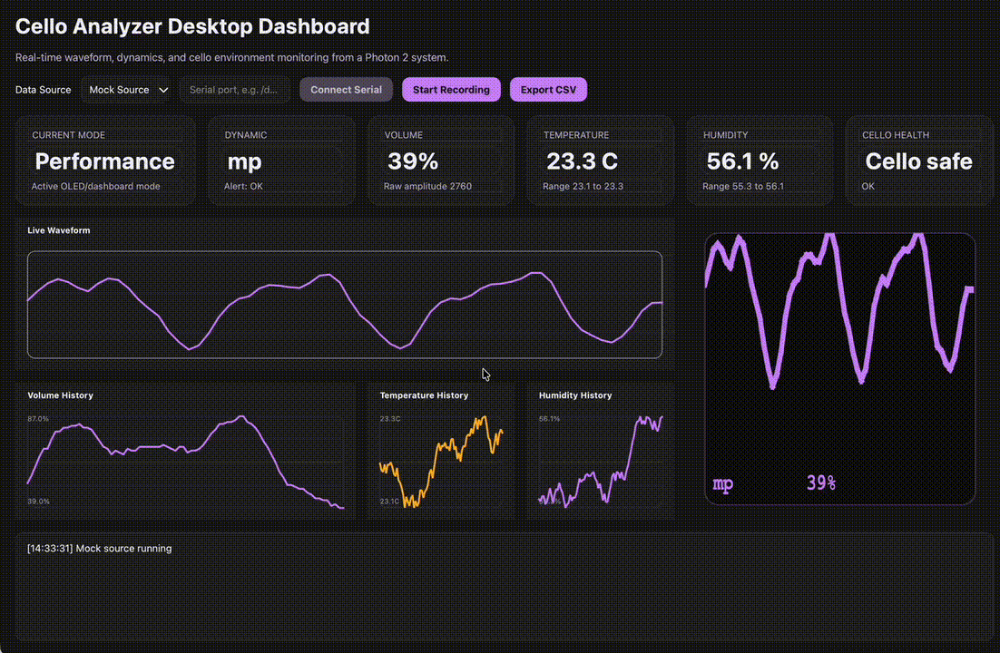

# Cello Analyzer Desktop Dashboard

PySide6 desktop application for monitoring a Photon 2 based Cello Analyzer in real time.



## Features

- Live waveform graph
- Volume meter and dynamic label
- Temperature and humidity monitoring
- OLED-style preview panel
- Session recording in memory
- CSV export
- Mock data mode for UI development
- Serial mode scaffold for live device integration

## Run

```bash
python3 -m venv .venv
source .venv/bin/activate
pip install -r desktop_dashboard/requirements.txt
python3 -m desktop_dashboard.main
```

## Data Sources

- `Mock Source`
  - generates realistic cello-like performance and environment data for testing the UI
- `Serial Source`
  - scaffold for reading line-based data from a Photon 2 over USB serial
  - supports JSON lines and the current `Amp: ... | Vol: ... | Dyn: ...` serial format

## Copyright

Copyright (c) 2026 wuisabel-gif. All rights reserved.

## Local practice measurement foundation

`desktop_dashboard.wav_import.load_wav(path)` loads only local 16-bit PCM WAV
(mono/stereo, 8–96 kHz, nonempty, at most 60 seconds / 32 MB).
`desktop_dashboard.practice.analyze(path)` returns 80 ms pitch/RMS frames at a
20 ms hop, with time in seconds from the file start. Pitch uses a normalized
squared-difference periodicity heuristic over approximately 55–1000 Hz.
Confidence is a periodicity score, not a calibrated probability. Quiet frames
(below about −50 dBFS RMS) and frames without a strong periodic candidate have
no pitch. Stereo is averaged to mono; opposing channels can cancel.

Trend is a centered 0.5 s median using continuous voiced frames only. It is
withheld at edges, gaps and octave-sized discontinuities. Short variation is
pitch minus trend, not a validated vibrato measure. Pitch is in cents relative
to A3 / 220 Hz, without inferring the intended note. Relative RMS is normalized
to each take's loudest frame: useful for shape, not absolute volume or SPL.
Different microphone gains, automatic gain control, noise and room acoustics
limit comparison. The analysis resamples with a simple FFT low-pass; transients
and boundaries can affect results. Polyphony, strong overtones and real bow
noise can produce errors, including octaves.

Tests use generated synthetic signals, not real cello validation:

```bash
.venv/bin/python -m unittest discover -s tests -v
```
